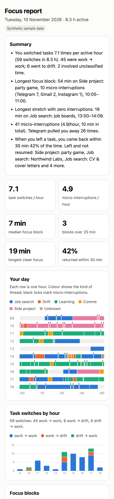
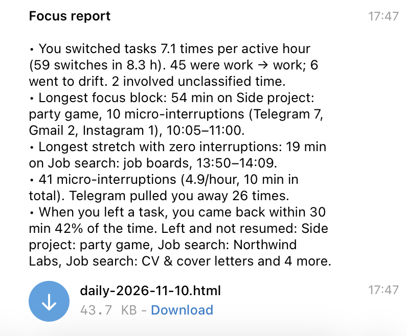

# focus-tracker

**Measure context switching between tasks, not apps.**

A personal analyzer built on [ActivityWatch](https://activitywatch.net). It groups
everything you do on your computer into *threads* (the task you were actually
working on) and reports how often you jump between them. A daily summary goes to
Telegram with a phone-friendly HTML report attached.

<p align="center"></p>

*The report above is generated from [synthetic data](sample_data/); open the full
[daily](examples/daily-report.html) and [weekly](examples/weekly-report.html) examples.*

## The problem

App-level trackers answer "how much time did I spend in Chrome?" and sort apps into
productive and distracting. That misses the switching I actually do. Gmail, Google
Docs, Notion and LinkedIn all count as "work", but moving from a cover letter to an
inbox to a job board and back is still a context switch, and it costs focus.

I suspected I don't drift to distractions much. I suspected I switch from one *work*
task to another *work* task constantly. To check, I needed to measure switching
between tasks, split into **work → work**, **work → drift** and **drift → work**.

## The approach: threads, not apps

Every stretch of activity is assigned to a thread such as `Job search: Northwind Labs`,
`Side project: party game` or `Drift: video`, regardless of the app it happened in.
An email to a recruiter goes on that company's application thread, not on "Comms".

```
ActivityWatch ─▶ timeline ─▶ classify ─▶ stints ─▶ focus blocks ─▶ metrics ─▶ HTML + Telegram
 window, AFK,     active time    YAML rules,   time on one    detours under 30s
 web watchers     only; browser   then Claude   thread          folded in as
                  → tab URL/title API (optional)                micro-interruptions
```

1. **Timeline.** Window, AFK and browser-tab events from the local ActivityWatch API
   are merged into one timeline of active time. Browser windows are replaced with the
   tab's URL and title from the web watcher.
2. **Classification.** Rules from an editable YAML file run first (app, domain, title
   and URL patterns, plus a list of companies you're applying to). Titles no rule
   matches can optionally be classified by the Claude API in batches. Results are
   cached by hash, so the same title is never sent twice.
3. **Noise handling, kept deliberately light.** Short switches are the point, so only
   true flicker (under 3 s, passing through a window while alt-tabbing) is dropped. A
   detour of up to 30 s that returns to the same thread, like a quick Telegram check,
   is a **micro-interruption**. It's counted and reported, but it doesn't end the focus
   block. Both thresholds are configurable.

## What it measures

| Metric | Definition |
|---|---|
| Task switches per hour | Changes of thread per active hour, split into work → work, work → drift, drift → work |
| Focus blocks | Time on one work thread (micro-interruptions included), at least 1 min. Reports the median, the longest and the number over 25 min |
| Clean focus | The longest stretch on one thread with no micro-interruption at all |
| Micro-interruptions | Count per hour and per focus block, what caused them (Telegram 23, Gmail 9 …), total time and time of day |
| Return rate | When you leave a task, how often you're back within 30 min, the median time to return, and the tasks you never came back to that day |
| Switch pairs | The most common moves, such as `Job search: CV → Comms: 14×` |
| Time of day | Switches, micro-interruptions and average block length per hour |
| Time per thread | Daily totals, plus task comms (email about a task) vs general comms |

Each focus block is listed with its interruptions:
*"54 min on Side project: party game, 10 micro-interruptions (Telegram 7, Gmail 2, Instagram 1)"*.

## Getting started

You need macOS, [ActivityWatch](https://activitywatch.net) running with the
[web watcher](https://docs.activitywatch.net/en/latest/watchers.html) installed in
your browser, and [uv](https://docs.astral.sh/uv/).

```bash
git clone https://github.com/annamuradyan1/focus-tracker.git
cd focus-tracker
uv sync --extra llm        # or just `uv sync` for rules-only mode
uv run focustracker init   # creates ~/.config/focus-tracker/{threads.yaml,.env}
```

Try it on synthetic data first:

```bash
uv run focustracker report --sample --date 2026-11-10 --open
```

Then on your own data:

```bash
uv run focustracker report --date 2026-11-18 --open   # one day (default: yesterday)
uv run focustracker report --week                     # Monday–Sunday of this week
uv run focustracker unclassified --days 7             # titles no rule covers yet
```

Edit `~/.config/focus-tracker/threads.yaml` to add your own companies, projects and
rules. The bundled [example](src/focustracker/defaults/threads.example.yaml) documents
every field. Run `unclassified` after a few days and turn the top titles into rules.

### Telegram delivery

Each morning the bot sends the summary as a message with the full HTML report attached:

<p align="center"></p>

1. In Telegram, open [@BotFather](https://t.me/BotFather), send `/newbot`, and pick a
   name and a username ending in `bot`. BotFather replies with a token.
2. Open a chat with your new bot and send it any message (bots can't message you first).
3. Get your chat ID: open `https://api.telegram.org/bot<TOKEN>/getUpdates` in a browser
   and copy `message.chat.id` from the response.
4. Put both in `~/.config/focus-tracker/.env` (see [.env.example](.env.example)) and check:

```bash
uv run focustracker send --test
```

### Schedule

```bash
uv run focustracker install-schedule
```

This installs a launchd agent that runs at 11:00 (yesterday's daily report), Sunday
21:00 (the weekly report) and at login. If the Mac was asleep, launchd runs the missed
job on wake. A state file makes every run idempotent, so nothing is sent twice. If
something fails, for example ActivityWatch isn't running, you get one short Telegram
message instead of silence. Remove it with `install-schedule --uninstall`.

## Privacy

This tool reads detailed personal data, and the repository is public, so:

- **Nothing personal lives in the repo.** Your rules, secrets, caches and reports are
  stored in `~/.config/focus-tracker` and `~/.local/share/focus-tracker`. The
  `.gitignore` also blocks real configs, `.env`, exports, reports and caches in case
  one ends up in the working tree.
- **Window titles are sent to the Claude API, if you enable it.** Titles that no rule
  matches are sent to Anthropic's API in batches for classification. Only the app name,
  the site's domain and the window/tab title are sent, never full URLs or page content.
  Turn this off with `llm.enabled: false` in your config, `--no-llm` on the command line,
  or by leaving `ANTHROPIC_API_KEY` empty. Rules-only mode sends nothing anywhere.
- **The cache stores hashes, not titles.**
- **Incognito tabs** are labelled "Private browsing" and never classified or sent.
- **Telegram** receives the summary and the HTML report, which contain thread names
  and times but no raw window titles.

The sample data and example reports use made-up companies, people and projects.

## Project layout

```
src/focustracker/
  aw.py           ActivityWatch REST client (buckets discovered by type, not hostname)
  timeline.py     not-AFK clipping and browser-tab resolution
  classify/       YAML rules, Claude API fallback, hash cache
  stints.py       flicker removal, stints, focus blocks, micro-interruptions
  metrics.py      every daily metric, as pure functions
  insights.py     the plain-language summary bullets
  report/         HTML templates and inline-SVG charts (no JavaScript)
  telegram.py     bot delivery
  schedule.py     due-job logic, state file, launchd agent
  fake_data.py    synthetic ActivityWatch days for demos and tests
```

Run the tests with `uv run pytest`.

## What I learned about myself

*To be written after a week of real data.*

<!-- e.g. switches per hour, share of work → work, top interrupters, best time of day -->

## Roadmap

- Optional real-time nudge on Telegram after a long stretch of rapid switching (the
  metrics already work on any time window, so this means running them on a rolling hour).

## License

[MIT](LICENSE)
